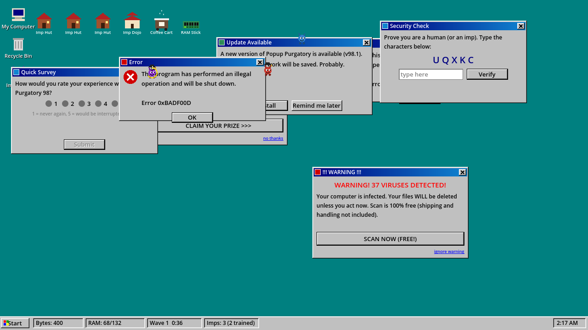

# Popup Purgatory

A Windows 98 desktop roguelite. Pop-ups keep appearing. You close them. Completing what a
pop-up asks (rate the survey, install the update, uncheck the newsletter boxes) pays more
than X-ing it out. Spend what you earn on a village of imps who close pop-ups for you.
Run out of system resources and the machine blue-screens. That's the run.

Built with [Godot 4.3](https://godotengine.org). No image assets: every window, button,
imp and building is drawn in code.



## Play

1. Install Godot 4.3 (standard build, not .NET).
2. Open `project.godot` in the editor and press F5, or run from a terminal:

   ```sh
   godot --path .
   ```

Controls are mouse-first. **Start** button or **B** opens the build menu, **1-7** picks a
building directly, **Esc** cancels placement, right-click also cancels. Drag windows by
their title bar.

The full design is in [`docs/DESIGN.md`](docs/DESIGN.md).

## Layout

```
project.godot
src/
  main.tscn, main.gd        root; swaps screens, hosts the screenshot tool
  autoload/game.gd          "Game" singleton: current run, meta save, screen flow
  core/                     pure logic, no nodes (unit tested)
    run_state.gd            bytes, RAM, waves, modifiers, crash
    popup_catalog.gd        every pop-up type and its numbers
    building_catalog.gd     every building and its cost curve
    upgrade_catalog.gd      between-wave picks
    spawn_schedule.gd       when and what spawns
    target_assigner.gd      imps claim pop-ups without collisions
    meta_save.gd            records, bank, perks (user://meta.json)
  ui/                       Win98 toolkit: palette/theme, bevels, buttons, window frame
  popups/                   PopupBase window, PopupContent base, spawner, content/*.gd
  imps/                     Imp (state machine + drawing), ImpManager
  village/                  Village grid, Building sprites, DesktopIcon
  desktop/                  Desktop screen, Taskbar, StartMenu, BreakDialog, ConfirmDialog
  screens/                  MainMenu (boot + unlock shop), BsodScreen (run summary)
  dev/autoplay.gd           bot that drives the real GUI with synthetic clicks
tests/                      headless unit tests + runner
tools/test.sh               import + tests + smoke run (what CI runs)
tools/screenshot.sh         render screens under Xvfb to screenshots/
```

## Dev tooling

Everything runs headless, so the whole loop works in CI and in a container.

```sh
tools/test.sh /path/to/godot          # import, 21 unit tests, 600-frame smoke run with the bot
godot --headless --path . -s tests/run_tests.gd
```

Command-line dev options go after `--`:

| flag | effect |
| --- | --- |
| `--screen=menu\|desktop\|bsod` | start on that screen |
| `--demo=1` | pre-build six buildings, spawn six pop-ups, grant 400 bytes |
| `--autoplay=1` | the bot plays: closes pop-ups through their real buttons, builds, picks upgrades |
| `--seed=N` | deterministic spawns and upgrades |
| `--ui=start\|break` | open the Start menu or the wave-break dialog immediately |
| `--noboot` | skip the boot text on the menu |
| `--screenshot=path.png --delay=S --shots=N` | save N screenshots S seconds apart, then quit |

Example, a rendered run with the bot under a virtual display:

```sh
LIBGL_ALWAYS_SOFTWARE=1 xvfb-run -a -s "-screen 0 1280x720x24" godot --path . \
  --rendering-driver opengl3 -- --screen=desktop --autoplay=1 --screenshot=screenshots/play.png --delay=9 --shots=6
```

## Status

Vertical slice. Every system in the design doc exists and is wired together: eight pop-up
types with completion tasks and traps, RAM pressure and the crash, waves with upgrade picks,
seven buildings, imps with training, meta-progression with four perks. Numbers are a first
guess and have not been playtested by a human yet. See `docs/DESIGN.md` for the roadmap.
